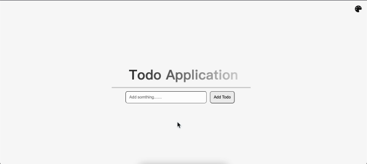

# 📝 Todo List｜React + TypeScript + Jest

這是一個以 React 與 TypeScript 開發的 Todo List 前端專案，使用 Jest 與 React Testing Library 撰寫元件測試，練習狀態管理、事件處理、型別定義與測試驗證。

## 🔧 技術

- React：建立 UI 元件，並使用 Hooks 管理任務與介面狀態。
- TypeScript：定義任務資料、狀態與事件處理的型別。
- Jest：執行自動化測試，驗證功能是否符合預期。
- SCSS：管理樣式、主題與動畫效果。
- Vite：提供本機開發與正式建置流程。
- Font Awesome：提供介面圖示。

---

## 專案預覽



[▶️ 點我看完整的展示影片](https://youtu.be/ybsd0ue6HcE)

## 📌 功能介紹

### Todo 管理功能

- **新增任務**：透過輸入框輸入後按下 `Enter` 或點擊按鈕即可新增。
- **刪除任務**：點擊刪除圖示，卡片會執行滑出動畫後刪除。
- **標記完成**：任務打勾後會有刪除線與淡出樣式。
- **編輯任務**：點選編輯後可直接修改文字，並使用 `Enter` 儲存。
- **錯誤提示**：防止儲存空內容，並顯示紅框閃爍提示。
- **重設狀態**：若使用者將已完成的任務重新編輯，系統會自動將其重設為未完成狀態，以避免混淆。

### 顏色與主題切換

- 點擊右上角調色盤按鈕切換「淺色 / 深色模式」
- 所有 UI 元件支援同步主題變換（按鈕、文字、背景等）

### 動畫效果

- 卡片刪除滑出動畫
- 編輯錯誤閃爍紅框提示
- 選單彈出時分段淡入動畫

## 📂 專案結構

```
Todo_List/
├── public/
├── src/
│   ├── App.tsx
│   ├── App.scss
│   ├── App.test.tsx
│   └── ...
├── babel.config.js
├── jest.config.js
├── package.json
└── README.md
```

## 📋 測試與檢查

本專案使用 Jest 搭配 React Testing Library 進行元件測試，並透過 Coverage 報告檢視程式碼的測試涵蓋範圍。
（測試範圍包含任務新增、編輯、刪除及狀態切換等功能)

📊 測試覆蓋率

```bash
| 測試指標 | 覆蓋率 (執行情況) |

| Statements | 98.46% (64/65) |

| Branches | 91.30% (42/46) |

| Functions | 100% (27/27) |

| Lines | 100% (57/57) |

# 執行測試並產生 Coverage 報告
npm test

# 執行 TypeScript 型別檢查
npx tsc --noEmit

# 執行 ESLint
npm run lint

# 建置專案
npm run build
```

---

## 📦 安裝與執行方式

```bash
git clone https://github.com/freddy990117/Todo_List.git
cd Todo_List
npm install
npm run dev
```

---

## 🛠 開發者筆記

- 使用 React Hooks 管理 Todo 資料與介面狀態。
- 使用 TypeScript 定義資料結構與狀態型別。
- 實作任務 CRUD（新增、編輯、刪除與完成狀態切換）。
- 使用 Jest 與 React Testing Library 測試元件互動及畫面更新。
- 使用 TypeScript 型別檢查、ESLint 與自動化測試協助維護程式品質。
- 使用 SCSS 管理介面樣式、主題與動畫效果。

---

## 📃 License

此專案僅用於個人學習與展示，無商業用途。

---

## 🙌 作者

Created by **Freddy Chang**  
轉職中前端工程師 🧑‍💻
